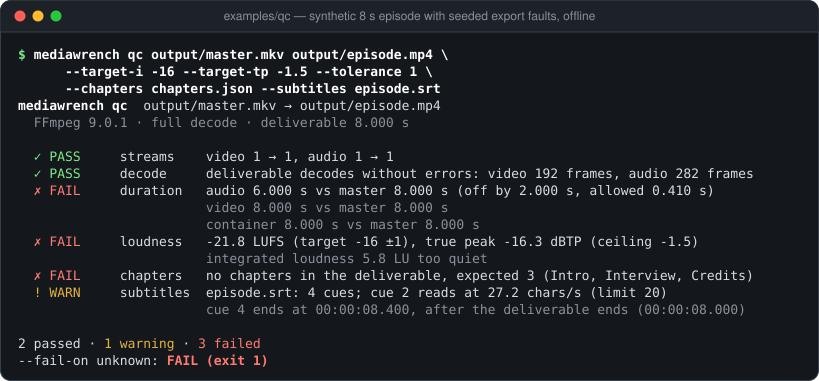

<p align="center">
  <picture>
    <source media="(prefers-color-scheme: dark)" srcset="assets/logo-dark.svg">
    
  </picture>
</p>

<p align="center">
  <strong>Catch the truncated audio, missed loudness target and dropped chapters before you ship the file.</strong><br>
  One offline CLI for subtitles, transcripts, audio and video: check deliverables, repair captions, turn ASR output into subtitles.
</p>

<p align="center">
  <a href="https://pypi.org/project/mediawrench/"></a>
  <a href="https://pypi.org/project/mediawrench/"></a>
  <a href="LICENSE"></a>
</p>

<p align="center">
  English · <a href="README.zh-CN.md">简体中文</a>
</p>

<p align="center">
  <strong>Five broken transcodes that ffprobe reads without an error: a header check accepts all 5. Decoding every stream, mediawrench rejects all 5 and passes the healthy file.</strong><br>
  <sub>Six synthetic cases (video dropped, file truncated, encode cut to 0.5 s, zero video frames, audio trimmed) plus one healthy control, FFmpeg 7.0.2. <a href="benchmarks/postflight/results.json">Stored result</a> · <a href="benchmarks/postflight/README.md">method</a> · reproduce with <code>python benchmarks/postflight/run.py</code>.</sub>
</p>

```sh
uvx mediawrench qc master.mov episode.mp4 --target-i -16 --target-tp -1.5 --tolerance 1   # or: pipx install mediawrench  /  pip install mediawrench
```

<p align="center">
  
</p>
<p align="center"><sub>Real output on the bundled synthetic episode (<code>examples/qc</code>: 8 s test pattern and tone, three faults seeded by <code>make_media.py</code>, every FFmpeg call exited 0). Regenerate with <code>assets/render_terminal.py</code>.</sub></p>

## Quick start

`qc` compares the file you are about to ship with the master it was made from. It is read-only and only runs the checks you ask for:

```sh
uvx mediawrench qc master.mov episode.mp4                                   # streams, decode, duration
uvx mediawrench qc master.mov episode.mp4 --target-i -16 --target-tp -1.5 --tolerance 1 \
  --chapters chapters.json --subtitles episode.srt                          # plus loudness, chapters, subtitles
uvx mediawrench qc master.mov episode.mp4 --format json --fail-on skipped   # CI: JSON, and no silent skips
```

To run the demo above from a clone (needs FFmpeg):

```sh
git clone https://github.com/tianhaogutum/mediawrench && cd mediawrench/examples/qc
python make_media.py
uvx mediawrench qc output/master.mkv output/episode.mp4 --target-i -16 --target-tp -1.5 \
  --tolerance 1 --chapters chapters.json --subtitles episode.srt
```

Exit status: `0` nothing at or above `--fail-on` (default `unknown`), `1` a check at or above it, `2` usage or input error. `output/episode-fixed.mp4` with `--subtitles episode-fixed.srt` passes all six checks.

## What `qc` checks

| Check | Fails when | Built on |
| --- | --- | --- |
| `streams` | The deliverable lost an audio or video stream (`--allow-drop` for intended drops) | [`postflight`](docs/postflight.md) |
| `decode` | A stream in either file raises a decode error or yields no frames | [`postflight`](docs/postflight.md) |
| `duration` | Container or per-stream decoded length differs from the master by more than 0.25 s + 2% | [`postflight`](docs/postflight.md) |
| `loudness` | Integrated LUFS is outside `--target-i` ± `--tolerance`, or true peak is above `--target-tp` | [`loudness`](docs/loudness.md) |
| `chapters` | Chapter count, titles, order, starts or ends differ from `--chapters FILE` (±1 ms) | [`chapters verify-media`](docs/chapters.md) |
| `subtitles` | The SRT/WebVTT does not parse, cues are out of order, or a cue starts after the deliverable ends. Warns on reading speed over 20 chars/s, lines over 42 characters, more than 2 lines, overlaps and cues running past the end | [`cutlist`](docs/cutlist.md), [`rollup`](docs/rollup.md), [`reflow`](docs/reflow.md) |

Each line is PASS, WARN, FAIL, UNKNOWN (ran but could not decide) or SKIPPED (not requested, or FFmpeg missing), with the numbers behind it. The checks are the other commands' libraries, not copies. Details: [docs/qc.md](docs/qc.md).

## All commands

| | Command | What it does | Docs |
| --- | --- | --- | --- |
| **Subtitles & captions** | `rollup` | Repair roll-up WebVTT captions into clean SRT/VTT with token provenance | [rollup](docs/rollup.md) |
| | `reflow` | Reflow ASR word timestamps into readable SRT cues (width, duration, reading speed) | [reflow](docs/reflow.md) |
| | `audacity` | Round-trip SRT/WebVTT timing edits through Audacity labels with a loss audit | [audacity](docs/audacity.md) |
| **Transcripts & speech** | `asr-audit` | Flag suspicious ASR segments (repeats, loops, off-VAD speech) for human review | [asr-audit](docs/asr-audit.md) |
| | `speakers` | Join diarization RTTM with ASR JSON into speaker-labelled JSON, Markdown or SRT | [speakers](docs/speakers.md) |
| | `cutlist` | Turn SRT cue selections into auditable LosslessCut cutlists, CSV and provenance | [cutlist](docs/cutlist.md) |
| | `chunks` | Split PCM WAV into sample-exact ASR chunks and stitch chunk transcripts back | [chunks](docs/chunks.md) |
| **Audio & video files** | `qc` | Pre-delivery gate: decode, duration, loudness, chapters and subtitles vs the master | [qc](docs/qc.md) |
| | `loudness` | Loudness-normalize audio; publish only after the final file passes LUFS/true peak | [loudness](docs/loudness.md) |
| | `postflight` | Decode a transcode against its source stream by stream: PASS, FAIL or UNKNOWN | [postflight](docs/postflight.md) |
| | `chapters` | Convert chapters between JSON, FFmetadata, text and Matroska XML, loss-audited | [chapters](docs/chapters.md) |

`mediawrench <command> --help` lists every option. Each command has runnable synthetic examples in `examples/<command>/`; run the quick starts below from a clone.

## Quick start by group

### Subtitles & captions

```sh
mediawrench rollup examples/rollup/rolling.vtt -o captions.srt          # also writes captions.srt.json (token map)
mkdir -p out
mediawrench reflow examples/reflow/pause.json -o out/pause.srt --report out/pause.report.json
mediawrench audacity export examples/audacity/synthetic.srt --labels out/labels.txt --sidecar out/sidecar.json
```

### Transcripts & speech

```sh
mediawrench asr-audit examples/asr-audit/transcript.json --vad examples/asr-audit/speech.json \
  --json out/report.json --csv out/flags.csv --review-srt out/review.srt
mediawrench speakers --asr examples/speakers/whisper.json --rttm examples/speakers/interview.rttm \
  --format srt --output out/interview.srt
mediawrench cutlist examples/cutlist/interview.srt --plan examples/cutlist/selection.json \
  --media-file interview.wav --output-prefix out/interview-proj --dry-run
python examples/chunks/demo.py --output out/chunks-demo
```

### Audio & video files (FFmpeg)

```sh
mediawrench loudness input.wav out.wav --target-i -16 --target-tp -1.5 --tolerance 0.5 --report report.json
mediawrench loudness out.wav --verify-only --target-i -16 --target-tp -1.5 --tolerance 0.5
mediawrench postflight source.mkv output.mkv --report report.json
mediawrench chapters convert examples/chapters/chapters.info.json out/chapters.txt \
  --from json --to text --allow-lossy --report out/text-audit.json
```

## FFmpeg

mediawrench runs the `ffmpeg`/`ffprobe` you installed (`apt install ffmpeg`, `brew install ffmpeg`, or `--ffmpeg`/`--ffprobe PATH`). It never downloads or bundles FFmpeg.

| Needs FFmpeg | Commands |
| --- | --- |
| Required | `loudness`, `postflight`; `qc` for its media checks (without FFmpeg they are SKIPPED and the subtitle check still runs) |
| Optional | `chapters verify-media`, `cutlist --ffprobe` |
| Never | `rollup`, `reflow`, `audacity`, `asr-audit`, `speakers`, `chunks` |

## How it compares

mediawrench checks, repairs and bridges what other tools produce. It does not encode, transcribe, diarize or edit, and it is meant to sit next to the tools below, not replace them.

| You use | It does | mediawrench adds |
| --- | --- | --- |
| FFmpeg, ffprobe, MediaInfo | Encode and decode; report container and stream headers | `qc` and `postflight` decode every stream of the result and compare it with the master. Header reports miss the faults in the benchmark above. |
| ffmpeg-normalize | Batch loudness normalization to EBU R128 and other targets, many output formats | `loudness` re-measures the final WAV in a fresh FFmpeg process and only publishes it if it passes; `qc` checks any deliverable against a target. For batch normalization across formats, ffmpeg-normalize is the broader tool. |
| Subtitle Edit | Interactive subtitle editing, sync, waveform, error checks (GUI) | Scriptable checks for CI (`qc`), roll-up caption repair (`rollup`), Audacity label round-trips with a loss audit (`audacity`). No editor. |
| WhisperX, faster-whisper, whisper.cpp | Transcription with word timestamps (WhisperX also aligns and diarizes) | Works on their JSON: readable cues from word timestamps (`reflow`), triage of repeats, loops and off-speech segments (`asr-audit`), chunking long WAVs and stitching the transcripts back (`chunks`). No model is loaded. |
| aeneas | Forced alignment of known text to audio | Nothing comparable: mediawrench does not align audio. `reflow` starts from word timestamps you already have. |
| pyannote.audio | Speaker diarization, RTTM output | `speakers` joins RTTM with ASR words and marks uncertain words `AMBIGUOUS` or `UNKNOWN` instead of guessing. |
| LosslessCut | Lossless cutting in a GUI | `cutlist` turns chosen SRT cues into a LosslessCut project (`.llc`) and CSV with provenance; you still cut in LosslessCut. |
| MKVToolNix | Matroska muxing and chapter editing | `chapters` converts chapter lists between JSON, FFmetadata, text and Matroska XML and refuses unapproved loss; `verify-media` checks the muxed file. |

## Trust and limits

- **Offline, no telemetry, no models.** Nothing is uploaded or downloaded. The only external programs are your FFmpeg executables, and only for the commands listed above.
- **Read-only unless you name an output.** `qc`, `postflight` and `loudness --verify-only` never modify media. Commands that write only write the output paths you name.
- **Reports say what was not checked.** UNKNOWN and SKIPPED are separate from PASS. `qc` proves streams decode with the right length; it does not judge picture or sound quality. Its loudness check uses FFmpeg `loudnorm` and is not a certified broadcast meter.
- **Tested.** 1,600+ test functions; CI on Python 3.11 to 3.14 on Linux and macOS, with real FFmpeg (FFmpeg tests skip, never fake, when it is missing).
- **Platforms.** Linux and macOS, Python 3.11+. Windows is untested.

mediawrench is independent and not affiliated with FFmpeg, Audacity, LosslessCut, MKVToolNix, Subtitle Edit, OpenAI Whisper, WhisperX or pyannote. Third-party notices: [THIRD_PARTY.md](THIRD_PARTY.md). The ten commands other than `qc` were standalone tools before; `mediawrench transcode-postflight` and the other old names point to the new command.

## License

MIT. See [LICENSE](LICENSE).

---

<p align="center">If mediawrench caught a broken file before your audience did, a star helps other people find it.</p>
