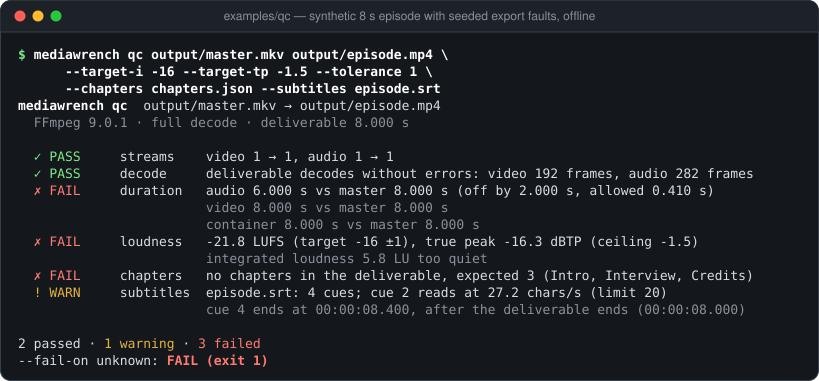

<p align="center">
  <picture>
    <source media="(prefers-color-scheme: dark)" srcset="assets/logo-dark.svg">
    
  </picture>
</p>

<p align="center">
  <strong>音频被截断、响度没达标、章节丢了——在文件发出去之前就发现。</strong><br>
  一个离线命令行工具，覆盖字幕、转写、音频和视频：交付前质检、修复字幕、把 ASR 输出变成可读字幕。
</p>

<p align="center">
  <a href="https://github.com/tianhaogutum/mediawrench/actions/workflows/ci.yml"></a>
  <a href="https://pypi.org/project/mediawrench/"></a>
  <a href="https://pypi.org/project/mediawrench/"></a>
  <a href="LICENSE"></a>
</p>

<p align="center">
  <a href="README.md">English</a> · 简体中文
</p>

<p align="center">
  <strong>5 个坏掉的转码文件，ffprobe 读起来都不报错：只看文件头的检查全部放行。mediawrench 把每条流都解码一遍，5 个全部拦下，健康文件照常通过。</strong><br>
  <sub>6 个合成用例（丢了视频、文件被截断、只编码了 0.5 秒、视频零帧、音频被裁短）加 1 个健康对照，FFmpeg 7.0.2。<a href="benchmarks/postflight/results.json">原始结果</a> · <a href="benchmarks/postflight/README.md">方法</a> · 复现：<code>python benchmarks/postflight/run.py</code>。</sub>
</p>

```sh
uvx mediawrench qc master.mov episode.mp4 --target-i -16 --target-tp -1.5 --tolerance 1   # 或：pipx install mediawrench  /  pip install mediawrench
```

<p align="center">
  
</p>
<p align="center"><sub>仓库自带合成样片上的真实输出（<code>examples/qc</code>：8 秒测试图案加正弦音，由 <code>make_media.py</code> 埋入三个故障，每一次 FFmpeg 调用都返回 0）。用 <code>assets/render_terminal.py</code> 重新生成。</sub></p>

## 快速开始

`qc` 把你准备交付的文件和它的母版逐项对比。只读，不改任何文件，而且只跑你要求的检查：

```sh
uvx mediawrench qc master.mov episode.mp4                                   # 流、解码、时长
uvx mediawrench qc master.mov episode.mp4 --target-i -16 --target-tp -1.5 --tolerance 1 \
  --chapters chapters.json --subtitles episode.srt                          # 再加响度、章节、字幕
uvx mediawrench qc master.mov episode.mp4 --format json --fail-on skipped   # CI 用：输出 JSON，跳过的检查也算失败
```

在克隆下来的仓库里跑上面的演示（需要 FFmpeg）：

```sh
git clone https://github.com/tianhaogutum/mediawrench && cd mediawrench/examples/qc
python make_media.py
uvx mediawrench qc output/master.mkv output/episode.mp4 --target-i -16 --target-tp -1.5 \
  --tolerance 1 --chapters chapters.json --subtitles episode.srt
```

退出码：`0` 没有任何检查达到 `--fail-on` 级别（默认 `unknown`），`1` 有检查达到，`2` 用法或输入错误。把交付文件换成 `output/episode-fixed.mp4`、字幕换成 `episode-fixed.srt`，六项检查全部通过。

## `qc` 检查什么

| 检查 | 什么情况算失败 | 基于 |
| --- | --- | --- |
| `streams` | 交付文件少了音频或视频流（有意去掉的用 `--allow-drop`） | [`postflight`](docs/postflight.md) |
| `decode` | 任一文件里有流解码报错，或者解不出帧 | [`postflight`](docs/postflight.md) |
| `duration` | 容器时长或某条流的解码时长与母版相差超过 0.25 秒 + 2% | [`postflight`](docs/postflight.md) |
| `loudness` | 综合响度不在 `--target-i` ± `--tolerance` 范围内，或真峰值高于 `--target-tp` | [`loudness`](docs/loudness.md) |
| `chapters` | 章节数量、标题、顺序、起止时间与 `--chapters FILE` 不一致（容差 ±1 毫秒） | [`chapters verify-media`](docs/chapters.md) |
| `subtitles` | SRT/WebVTT 解析失败、字幕顺序错乱，或某条字幕在交付文件结束后才开始。阅读速度超过每秒 20 字符、单行超过 42 字符、超过 2 行、相互重叠、超出片尾时给出警告 | [`cutlist`](docs/cutlist.md)、[`rollup`](docs/rollup.md)、[`reflow`](docs/reflow.md) |

每一行的状态是 PASS、WARN、FAIL、UNKNOWN（跑了但无法判断）或 SKIPPED（没要求，或没装 FFmpeg），后面跟着判断依据的数字。这些检查直接调用其他子命令的库，不是另写一套。详见 [docs/qc.md](docs/qc.md)。

## 全部命令

| | 命令 | 作用 | 文档 |
| --- | --- | --- | --- |
| **字幕** | `rollup` | 把滚动式（roll-up）WebVTT 字幕修成干净的 SRT/VTT，每个词都有来源记录 | [rollup](docs/rollup.md) |
| | `reflow` | 按行宽、时长、阅读速度，把 ASR 词级时间戳重排成可读的 SRT | [reflow](docs/reflow.md) |
| | `audacity` | 借 Audacity 标签轨调整 SRT/WebVTT 时间，往返之后做损失审计 | [audacity](docs/audacity.md) |
| **转写与语音** | `asr-audit` | 标出可疑的 ASR 片段（重复、循环、VAD 之外的"语音"），交给人工复核 | [asr-audit](docs/asr-audit.md) |
| | `speakers` | 把说话人分离的 RTTM 和 ASR JSON 合并成带说话人的 JSON、Markdown 或 SRT | [speakers](docs/speakers.md) |
| | `cutlist` | 把选中的 SRT 字幕变成可审计的 LosslessCut 剪辑表、CSV 和来源记录 | [cutlist](docs/cutlist.md) |
| | `chunks` | 把 PCM WAV 按采样点精确切块送去 ASR，再把各块转写拼回原时间轴 | [chunks](docs/chunks.md) |
| **音视频文件** | `qc` | 交付前质检：解码、时长、响度、章节、字幕，全部对照母版 | [qc](docs/qc.md) |
| | `loudness` | 响度标准化；最终文件的 LUFS 和真峰值复测通过后才发布 | [loudness](docs/loudness.md) |
| | `postflight` | 逐条流解码，比对转码结果和源文件：PASS、FAIL 或 UNKNOWN | [postflight](docs/postflight.md) |
| | `chapters` | 在 JSON、FFmetadata、纯文本、Matroska XML 之间转换章节，带损失审计 | [chapters](docs/chapters.md) |

`mediawrench <命令> --help` 列出所有选项。每个命令在 `examples/<命令>/` 下都有可运行的合成示例；下面的快速开始请在克隆的仓库里运行。

## 分组快速开始

### 字幕

```sh
mediawrench rollup examples/rollup/rolling.vtt -o captions.srt          # 同时写出 captions.srt.json（词级来源）
mkdir -p out
mediawrench reflow examples/reflow/pause.json -o out/pause.srt --report out/pause.report.json
mediawrench audacity export examples/audacity/synthetic.srt --labels out/labels.txt --sidecar out/sidecar.json
```

### 转写与语音

```sh
mediawrench asr-audit examples/asr-audit/transcript.json --vad examples/asr-audit/speech.json \
  --json out/report.json --csv out/flags.csv --review-srt out/review.srt
mediawrench speakers --asr examples/speakers/whisper.json --rttm examples/speakers/interview.rttm \
  --format srt --output out/interview.srt
mediawrench cutlist examples/cutlist/interview.srt --plan examples/cutlist/selection.json \
  --media-file interview.wav --output-prefix out/interview-proj --dry-run
python examples/chunks/demo.py --output out/chunks-demo
```

### 音视频文件（需要 FFmpeg）

```sh
mediawrench loudness input.wav out.wav --target-i -16 --target-tp -1.5 --tolerance 0.5 --report report.json
mediawrench loudness out.wav --verify-only --target-i -16 --target-tp -1.5 --tolerance 0.5
mediawrench postflight source.mkv output.mkv --report report.json
mediawrench chapters convert examples/chapters/chapters.info.json out/chapters.txt \
  --from json --to text --allow-lossy --report out/text-audit.json
```

## 关于 FFmpeg

mediawrench 调用你自己安装的 `ffmpeg`/`ffprobe`（`apt install ffmpeg`、`brew install ffmpeg`，或用 `--ffmpeg`/`--ffprobe PATH` 指定），从不下载或捆绑 FFmpeg。

| 是否需要 FFmpeg | 命令 |
| --- | --- |
| 必需 | `loudness`、`postflight`；`qc` 的媒体检查（没装时标为 SKIPPED，字幕检查照常运行） |
| 可选 | `chapters verify-media`、`cutlist --ffprobe` |
| 不需要 | `rollup`、`reflow`、`audacity`、`asr-audit`、`speakers`、`chunks` |

## 和现有工具的关系

mediawrench 负责检查、修复和衔接其他工具的产出。它不编码、不转写、不做说话人分离，也不是编辑器；它和下面这些工具搭配使用，而不是取代它们。

| 你在用 | 它做的事 | mediawrench 补上的 |
| --- | --- | --- |
| FFmpeg、ffprobe、MediaInfo | 编解码；报告容器和流的头信息 | `qc` 和 `postflight` 把结果的每条流都解码，并与母版比对。只看头信息会漏掉上面基准里的那些故障。 |
| ffmpeg-normalize | 批量响度标准化（EBU R128 等目标），支持多种输出格式 | `loudness` 在新的 FFmpeg 进程里复测最终 WAV，通过才发布；`qc` 可以拿任何交付文件对照目标值检查。要跨格式批量标准化，ffmpeg-normalize 更全面。 |
| Subtitle Edit | 图形界面的字幕编辑、同步、波形、错误检查 | 可写进 CI 的检查（`qc`）、滚动字幕修复（`rollup`）、经 Audacity 标签往返并审计损失（`audacity`）。不提供编辑器。 |
| WhisperX、faster-whisper、whisper.cpp | 带词级时间戳的转写（WhisperX 还做对齐和说话人分离） | 处理它们输出的 JSON：按词级时间戳生成可读字幕（`reflow`），筛出重复、循环、非语音段（`asr-audit`），把长 WAV 切块再把转写拼回去（`chunks`）。不加载任何模型。 |
| aeneas | 把已知文本强制对齐到音频 | 没有对应功能：mediawrench 不做音频对齐，`reflow` 从你已有的词级时间戳出发。 |
| pyannote.audio | 说话人分离，输出 RTTM | `speakers` 把 RTTM 和 ASR 词合并，拿不准的词标为 `AMBIGUOUS` 或 `UNKNOWN`，不去猜。 |
| LosslessCut | 图形界面的无损剪切 | `cutlist` 把选中的 SRT 字幕变成 LosslessCut 工程（`.llc`）和带来源记录的 CSV；剪切仍在 LosslessCut 里完成。 |
| MKVToolNix | Matroska 封装和章节编辑 | `chapters` 在 JSON、FFmetadata、纯文本、Matroska XML 之间转换章节，未经批准的损失一律拒绝；`verify-media` 检查封装后的文件。 |

## 可信度与局限

- **离线、无遥测、无模型。** 不上传也不下载任何东西。唯一的外部程序是你的 FFmpeg，而且只用于上面列出的命令。
- **不指定输出就只读。** `qc`、`postflight`、`loudness --verify-only` 从不修改媒体文件。会写文件的命令只写你指定的输出路径。
- **报告会说明哪些没检查。** UNKNOWN 和 SKIPPED 与 PASS 分开。`qc` 证明各条流能解码、时长正确，但不评判画质和音质；响度检查基于 FFmpeg `loudnorm`，不是经过认证的广播响度表。
- **有测试。** 1,600 多个测试函数；CI 在 Linux 和 macOS 上跑 Python 3.11 到 3.14，并使用真实 FFmpeg（缺少 FFmpeg 时相关测试跳过，绝不伪造）。
- **平台。** Linux 和 macOS，Python 3.11+。Windows 未测试。

mediawrench 是独立项目，与 FFmpeg、Audacity、LosslessCut、MKVToolNix、Subtitle Edit、OpenAI Whisper、WhisperX、pyannote 均无关联。第三方声明见 [THIRD_PARTY.md](THIRD_PARTY.md)。除 `qc` 外的十个命令以前是独立工具；`mediawrench transcode-postflight` 等旧名称会提示对应的新命令。

## 许可证

MIT，见 [LICENSE](LICENSE)。

---

<p align="center">如果 mediawrench 帮你在观众之前发现了一个坏文件，点个 star 能让更多人找到它。</p>
